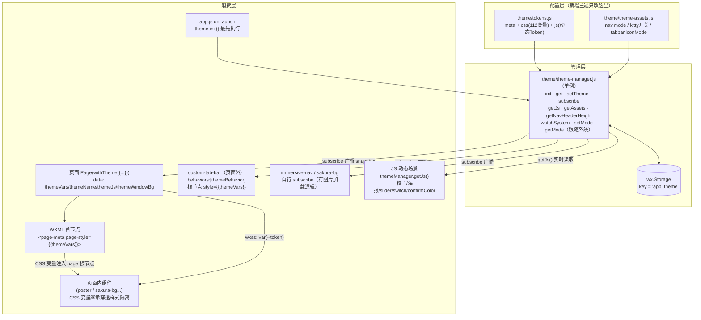

# Yuki小厨房主题系统开发规范

> 版本：v1.1 ｜ 基于主题系统基建（`218745d`）+ 跟随系统模式 ｜ 2026-11-19
> 文档定位：项目级技术规范。供 AI Coding Agent 与开发人员新增主题、维护主题时直接参照实施。
> **本规范中所有文件路径、函数名、类名、配置字段均与仓库真实代码一致，可直接照抄实施。**

---

## 目录

1. [主题系统架构](#一主题系统架构)
2. [Design Tokens 规范](#二design-tokens-规范)
3. [主题资源管理](#三主题资源管理)
4. [主题适配规范](#四主题适配规范)
5. [新增主题标准流程](#五新增主题标准流程)
6. [主题切换与扩展机制](#六主题切换与扩展机制)
7. [开发约束与验收标准](#七开发约束与验收标准)

---

## 一、主题系统架构

### 1.1 整体设计

主题系统分三个正交层次，业务代码只依赖「语义 Token」，不感知具体主题：

| 层次 | 职责 | 载体文件 |
|---|---|---|
| 公共组件层 | 布局、排版、卡片/按钮/chip/导航/TabBar/弹窗/骨架屏的**结构** | `miniprogram/app.wxss` + 各页面/组件 `.wxss` |
| 主题样式层 | 颜色、边框、阴影、渐变、遮罩等**视觉属性** | `miniprogram/theme/tokens.js`（`css` 段 + `js` 段） |
| 主题资源层 | 图片资源的显示开关、导航布局模式、图标方案 | `miniprogram/theme/theme-assets.js` |

当前已注册三套主题：`sakura`（默认）、`github-light`、`github-dark`。

### 1.2 文件目录与职责

```
miniprogram/theme/                  # ★ 主题系统全部基建代码
├── tokens.js                       # Design Tokens 单一事实源
│                                   #   每主题 = { meta, css, js }，模块加载时自动生成 varsString
├── theme-assets.js                 # 主题资源层：nav 模式 / kitty 装饰开关 / tabbar 图标策略
├── theme-manager.js                # 单例管理器：init/get/setTheme/subscribe/getJs/getAssets/getNavHeaderHeight
│                                   #   + 跟随系统：watchSystem/checkSystemTheme/getMode/setMode/configureSystemThemes
├── theme-page.js                   # 页面包装器 withTheme(config)
└── theme-component.js              # 组件 Behavior（themeBehavior），供页面外组件使用

miniprogram/pages/appearance/       # 「我的 → 外观」主题切换页（四件套）
miniprogram/app.js                  # onLaunch 最早调用 theme.init()
miniprogram/app.wxss                # 公共组件层：全部颜色走 var(--token, 樱花回退值)
miniprogram/utils/util.js           # getNavMetrics()：导航让位高度单一事实源
```

### 1.3 架构图



### 1.4 主题注册机制

主题注册 = **在 `tokens.js` 与 `theme-assets.js` 各添加一个同名条目**，无其他注册点。`theme-manager.js` 不写死任何主题名，合法性校验为「两个文件都有该 key」：

```js
// theme-manager.js（真实代码）
function isValid(name) {
  return Object.prototype.hasOwnProperty.call(TOKENS, name) &&
         Object.prototype.hasOwnProperty.call(ASSETS, name);
}
```

只在一个文件注册的主题会被 `list()` 过滤、被 `setTheme()` 拒绝，**不会导致运行时崩溃**——但属于配置错误，验收时必须避免。

### 1.5 配置传递链路（切换一次主题发生了什么）

```
用户点击外观页卡片
  → appearance.js onSelect() → themeManager.setTheme(name)
    → 校验 isValid(name)
    → currentName = name；wx.setStorageSync('app_theme', name)
    → snapshot(name) 组装 { name, css, js, meta, assets, varsString }
    → 遍历 subscribers 广播 snapshot
      ├─ 每个 withTheme 页面：_applyTheme(snap) → setData({ themeVars, themeName, themeJs, themeWindowBg [, navHeight] }) → _syncNavBar()
      │    → page-meta page-style 更新 → page 根节点 CSS 变量整体替换 → 全页 wxss var(--token) 即时生效
      ├─ custom-tab-bar（themeBehavior._applyThemeSnap）→ 根节点 style 更新 + iconMode 切换图标
      ├─ immersive-nav._onTheme(snap) → navMode 切换（illustrated 加载插画 / minimal 隐藏）
      └─ sakura-bg.syncTheme() → enabled 开关（GitHub 主题不渲染 Kitty）
    → 下次 Canvas/海报/showModal 调用 themeManager.getJs() 时自动拿到新色值
```

**关键性质**：整个链路只 setData 视觉字段，不触碰业务 data（菜品、抽卡结果、表单输入均不受影响）。

---

## 二、Design Tokens 规范

### 2.1 Token 结构

每个主题在 `tokens.js` 中包含三段：

```js
'主题名': {
  meta: {                       // 元信息：外观页展示 + 预览色板
    label: '显示名',
    desc: '一句话描述',
    preview: { bg, card, text, accent, accentSoft, border }   // 6 色，外观页迷你预览用
  },
  css: { '--token-name': '值', ... },   // 103 个基础 CSS 变量（WXSS 消费）
  js: { ... }                            // 动态 Token（Canvas/控件/API 消费，见 2.4）
}
```

模块加载时 `tokens.js` 尾部代码自动完成两件事（**不要手动维护其产物**）：
1. 按 `ALIAS_MAP` 为每主题追加 9 个兼容别名（合计 **112 个 key**）；
2. 预拼 `varsString`（`"--k1:v1;--k2:v2;..."`），供 page-meta / 组件根节点注入。

### 2.2 CSS Token 分组清单（103 基础 + 9 别名）

「默认值」列为 sakura 主题值（也是所有 WXSS 中 `var()` 的回退值）。**任何新主题必须提供全部 103 个基础 key，缺失会静默回退樱花粉，属验收不通过项。**

#### 背景类（8）

| Token | 含义 | 默认值(sakura) | 典型使用处 |
|---|---|---|---|
| `--bg-page` | 页面底色 | `#FFF7FA` | app.wxss `page` |
| `--bg-card` | 卡片背景（可带透明度） | `rgba(255,255,255,0.88)` | app.wxss `.card` `.skeleton-item` |
| `--bg-card-solid` | 卡片实底色（需不透出下层时） | `#FFFFFF` | dishes 搜索栏/侧栏选中项、弹窗面板 |
| `--bg-sunken` | 凹陷区/输入框底色 | `#FDF5F9` | 表单输入、tag-input、field-input |
| `--bg-hover` | 按压反馈底色 | `#F7EDF1` | fab-manual:active |
| `--bg-active` | 激活/取消类底色 | `#FBEFF5` | fab-cancel |
| `--bg-placeholder` | 图片占位底色 | `#FFEAF2` | 无封面图时 dish-img-ph/today-img-ph/hero-ph |
| `--bg-sheet` | 底部抽屉面板底色 | `#FFFFFF` | dishes fab-sheet |

#### 文字类（5）

| Token | 含义 | 默认值 | 典型使用处 |
|---|---|---|---|
| `--text-primary` | 主文字 | `#4A2C3A` | 标题、菜名、正文 |
| `--text-secondary` | 次要文字 | `#9C7B8C` | 描述、副标签 |
| `--text-hint` | 提示文字 | `#C9A8B8` | 空态、placeholder、日期 |
| `--text-faint` | 最弱文字/箭头 | `#D8BAC9` | menu-arrow、footer、`.ph` |
| `--text-on-accent` | 强调色底上的文字 | `#FFFFFF` | btn-primary、选中 chip |

#### 强调色系（7）

| Token | 含义 | 默认值 | 典型使用处 |
|---|---|---|---|
| `--color-accent` | 品牌强调色 | `#FF8FB8` | 主按钮、链接、选中态 |
| `--color-accent-strong` | 强调加深（按钮/链接重色） | `#E85D91` | poster 弹窗按钮、r-link |
| `--color-accent-deep` | 强调衍生（标签/说明文字） | `#D96C99` | hero-sub、stat-label |
| `--color-accent-dark` | 强调最深（预留/TabBar激活文字参考） | `#A73568` | — |
| `--color-accent-soft` | 强调浅底 | `#FFF0F6` | btn-ghost、chip、filter-picker |
| `--color-accent-softer` | 强调更浅底 | `#FBEFF5` | chip-plain、status-btn、侧栏 |
| `--color-accent-border` | 强调色边框 | `#FFD6E7` | sheet-opt、status-btn.on、输入框边框 |

#### 边框类（5）

| Token | 含义 | 默认值 | 典型使用处 |
|---|---|---|---|
| `--border-default` | 常规分割线/边框 | `#F8E3EC` | cat-stats 顶边、log-line |
| `--border-soft` | 更浅分割线（列表行间） | `#FCEFF5` | menu-item、filter-row、form-item |
| `--border-strong` | 重边框（TabBar 顶线等） | `#F0C0D4` | tabbar border-top |
| `--card-border` | 卡片描边（可 rgba） | `rgba(255,143,184,0.16)` | app.wxss `.card` |
| `--border-dashed` | 虚线边框（上传格） | `#F0C9DD` | img-add |

#### 功能色（5）

| Token | 含义 | 默认值 | 典型使用处 |
|---|---|---|---|
| `--color-success` | 成功/正向状态文字 | `#639922` | chip-success |
| `--color-success-bg` | 成功底色 | `#EAF3DE` | chip-success |
| `--color-star` | 星级金色 | `#FF9500` | star.on、dish-rating |
| `--star-off` | 未点亮星级 | `#F8E3EC` | .star |
| `--divider-strong` | 重分隔（统计卡竖线） | `#F5C9DD` | stat-divider |

#### 阴影类（6）

| Token | 含义 | 典型使用处 |
|---|---|---|
| `--shadow-card` | 卡片轻阴影 | `.card` |
| `--shadow-panel` | 弹窗面板阴影 | import-panel、分类管理 modal |
| `--shadow-fab` / `--shadow-fab-drag` | FAB 常态/拖动阴影 | dishes `.fab` |
| `--shadow-accent` | 强调按钮大阴影 | action-accept、pf-save |
| `--shadow-card-heavy` | 抽卡卡面重阴影（多层复合） | random `.face-front` |

#### 渐变类（12）

| Token | 含义 | 典型使用处 |
|---|---|---|
| `--gradient-hero` | 首页问候卡/统计卡底 | index `.hero`、mine `.stats-card` |
| `--gradient-fab` | FAB 圆钮 | dishes `.fab` |
| `--gradient-primary` | 主按钮渐变 | import-btn-primary |
| `--gradient-bar` | 条形图填充 | mine `.cat-bar-fill` |
| `--gradient-card-back` | 抽卡卡背主渐变 | random `.face-back` |
| `--gradient-card-face` | 抽卡卡面底 | random `.face-front` |
| `--gradient-toolbar` | 卡片顶部工具栏 | random `.card-toolbar` |
| `--gradient-sheet` | 分享抽屉面板 | random `.sheet` |
| `--gradient-overlay` | 揭晓弹层全屏氛围底 | random `.ov-bg` |
| `--gradient-poster-icon` | 分享抽屉「海报」图标底 | random `.so-ic.poster` |
| `--gradient-ai` | AI 识别卡渐变 | dishes `.fab-ai-card` |
| `--gradient-ai-btn` | AI 按钮/图标渐变 | btn-ai-main、ai-guide-icon、ai-tag |
| `--ai-guide-bg` | AI 引导卡淡渐变底 | dish-edit `.ai-guide` |

#### 抽卡卡背专属（10）

| Token | 含义 |
|---|---|
| `--card-back-pattern` / `--card-back-pattern-soft` | 卡背圆点纹样色 |
| `--card-back-emblem` / `--card-back-emblem-border` | 中央徽章文字色/描边 |
| `--card-back-glow` | 徽章外发光 |
| `--card-back-arc` / `--card-back-arc2` | 内框虚线/实线 |
| `--card-back-shadow` | 卡背复合阴影 |
| `--card-back-inner` | 徽章内部径向渐变 |
| `--card-face-border` | 卡面描边 |

#### 抽卡卡面/特效（6）

| Token | 含义 | 备注 |
|---|---|---|
| `--card-sheen-tint` | 扫光尾色 | |
| `--card-face-fade` | 照片底部渐隐衔接色 | 深色主题须为卡片底色的 rgba |
| `--card-name-shadow` | 菜名 text-shadow | 深色主题为深色阴影 |
| `--glow-rgb` | 蓄力光晕 RGB 三元组 | **值为 `"r, g, b"` 字符串**，WXSS 中用 `rgba(var(--glow-rgb), 0.42)` 展开 |
| `--flash-tint` / `--flash-edge` | 中心闪光两段色 | |

#### 遮罩类（3）

| Token | 含义 | 典型使用处 |
|---|---|---|
| `--mask-light` | 普通弹窗遮罩 | import-mask、分类管理 mask、re-scan |
| `--mask-heavy` | 抽屉/面板重遮罩 | fab-mask、tp-mask |
| `--mask-scan` | AI 扫描全屏遮罩 | dish-edit scan-overlay |

#### TabBar 专属（7）

| Token | 含义 |
|---|---|
| `--tabbar-bg` / `--tabbar-border` | 条背景 / 顶部分割线 |
| `--tabbar-text` / `--tabbar-text-active` | 未选中/选中文字（选中字体图标同色） |
| `--tabbar-center-bg` / `--tabbar-center-border` / `--tabbar-center-shadow` | 凸起骰子钮 底色/描边/阴影 |

#### 导航专属（5）

| Token | 含义 | 备注 |
|---|---|---|
| `--nav-fallback` | immersive-nav 兜底渐变底 | 插画加载前 / minimal 模式常驻 |
| `--nav-veil` | 插画上的轻罩 | minimal 主题设为透明 |
| `--nav-fade` | 底部渐隐（终点=页面底色） | |
| `--navbar-fg` | custom-navbar 标题/返回色 | 樱花=白（配插画深底），GitHub=主题文字色 |
| `--navbar-shadow` | custom-navbar 文字投影 | minimal 主题设 `none` |

#### 其他组件专属（15）

| Token | 含义 | 使用处 |
|---|---|---|
| `--skeleton-base` / `--skeleton-shine` | 骨架屏底色/流光色 | app.wxss 骨架 |
| `--grip-color` | 抽屉抓手条 | sheet-grip、fab-handle |
| `--btn-disabled-bg` / `--btn-disabled-text` | 禁用按钮 | btn-primary.btn-disabled |
| `--btn-reject-bg` / `--btn-reject-text` / `--btn-reject-border` | 弹层「不想吃」按钮 | random action-reject |
| `--heat-1` / `--heat-2` / `--heat-3` | 吃历热力三档 | mine 日历 cal-dot |
| `--bg-poster-full` | 全屏海报预览底色 | random poster-full |
| `--poster-preview-fg` / `--poster-preview-border` / `--poster-preview-btn-bg` | 海报预览头行按钮 | pf-back/pf-save-top |
| `--badge-bg` | 封面角标 | dish-edit cover-badge |

#### AI 功能专属（8）

| Token | 含义 |
|---|---|
| `--ai-color` / `--ai-color-deep` | AI 主色/深色（紫系，三主题均保留紫色语义） |
| `--ai-shadow` | AI 卡阴影 |
| `--ai-bg-soft` | AI 横幅/建议条底色 |
| `--ai-border-dashed` | AI 虚线边框/扫描角标 |
| `--scan-line-glow` | 扫描线光晕 |
| `--ai-pulse-glow` | AI 引导卡脉冲光圈 |

#### 兼容别名（9，由 ALIAS_MAP 自动生成，禁止手写）

`--color-primary`、`--color-primary-light`、`--color-primary-dark`、`--color-bg`、`--color-card`、`--color-text`、`--color-text-sub`、`--color-text-hint`、`--color-border` —— 分别映射到 `--color-accent`、`--color-accent-soft`、`--color-accent-deep`、`--bg-page`、`--bg-card-solid`、`--text-primary`、`--text-secondary`、`--text-hint`、`--border-default`。**新代码禁止使用别名**，仅为历史 WXSS 兼容保留；新增别名只改 `ALIAS_MAP`。

### 2.3 js 动态 Token（无法走 WXSS 的场景）

每主题 `js` 段结构（三主题 key 结构必须完全一致）：

```js
js: {
  mode: 'light' | 'dark',                        // page-meta background-text-style 用
  navBar: { frontColor, backgroundColor },       // wx.setNavigationBarColor（withTheme._syncNavBar）
  windowBg: '#RRGGBB',                           // page-meta background-color / root-background-color
  slider: { active, track },                     // <slider activeColor/backgroundColor>
  switchColor: '#RRGGBB',                        // <switch color>
  confirmColor: '#RRGGBB',                       // wx.showModal confirmColor
  particles: {                                   // random.js 抽卡 Canvas 粒子
    gather: ['r,g,b', 'r,g,b'],                  // 蓄力汇聚（rgba 三元组字符串）
    burst: ['#hex', ...5个],                     // 揭晓爆发星芒
    pop: ['#hex', ...3个],                       // 换一道点缀
    rings: ['r,g,b', 'r,g,b']                    // 双冲击波环
  },
  poster: {                                      // components/poster Canvas 绘制
    bg, brand, brandLight, textPrimary,
    textSecondary, divider, note, placeholderStroke   // 8 个 '#hex'
  }
}
```

消费方（真实代码位置）：

| 消费方 | 读取方式 |
|---|---|
| `pages/random/random.js` spawnGather/spawnBurst/spawnPop | `themeManager.getJs().particles` |
| `components/poster/index.js` `P()` 函数 | `themeManager.getJs().poster` |
| `pages/random/random.wxml` slider/switch | `{{themeJs.slider.active}}` `{{themeJs.switchColor}}` |
| 各页面 `wx.showModal` | `confirmColor: themeManager.getJs().confirmColor` |
| `theme-page.js` `_syncNavBar` | `js.navBar.frontColor/backgroundColor` |
| 各页面 page-meta | `{{themeJs.mode === 'dark' ? 'light' : 'dark'}}` |

### 2.4 硬编码禁令

**业务页面/组件 WXSS 中禁止出现任何主题相关的字面颜色**（hex、rgb()、rgba()、渐变中的色标）。允许的例外（当前代码中的既有事实）：

- 纯黑/纯白/透明的**结构性**用法：`rgba(0,0,0,0.5)`（图片删除角标底）、`#fff`（凸起骰子钮内图标、扫光高光条）；
- 微信品牌绿 `linear-gradient(135deg, #4CC05A, #2FA84F)`（分享抽屉「微信好友」图标，跨主题恒定）；
- AI 卡内部的白色高光/星点（`rgba(255,255,255,...)`，渐变底上的装饰，跨主题恒定）。

判断标准：**该颜色在不同主题下是否需要变化？需要 → 必须建 Token；不需要 → 允许字面量并加注释说明。**

WXSS 中引用 Token 的标准写法（带回退值，回退值 = sakura 值）：

```css
.hero-greeting { color: var(--text-primary, #4A2C3A); }
```

---

## 三、主题资源管理

### 3.1 资源分类与边界

| 类别 | 资源 | 存放 | 主题相关性 |
|---|---|---|---|
| 公共业务资源 | 菜品照片、用户上传图片 | 云存储 `dishes/`（临时 URL 访问） | 无关，所有主题共用 |
| 品牌资源 | 「Yuki小厨房」品牌名 | poster Canvas 文字绘制 | 颜色随 `js.poster.brand` |
| 主题专属资源 | Hello Kitty 装饰图 | 云存储 `cloud://.../assets/kitty-deco.webp`（key=`kitty`） | 仅 sakura 显示 |
| 主题专属资源 | 顶部厨房插画 | 云存储 `cloud://.../assets/header-kitchen.jpg`（key=`header`） | 仅 sakura（illustrated）显示 |
| 主题专属资源 | TabBar PNG 图标 ×8 | `/custom-tab-bar/icons/*.png` | 仅 `iconMode:'image'` 主题使用 |
| 公共图标 | bi 字体图标 | `app.wxss` 内联 base64 子集（89 码位）；组件内自带 `@font-face`+`.bi` | 颜色随 CSS 变量，天然适配 |

### 3.2 theme-assets.js 配置结构（真实字段）

```js
'主题名': {
  nav: {
    mode: 'illustrated' | 'minimal',  // immersive-nav 布局模式
    extraHeight: 24 | 0,              // 导航插画延伸带高度(px)——决定「导航条自身高度」，
                                      //   参与 getNavHeaderHeight()，immersive-nav 与页面让位共用
    contentTopOffset: 0 | 16,         // 内容区顶部「额外视觉间距」(px)——与导航高度解耦，
                                      //   只决定内容起始位置，不改导航条高度；缺省/非法按 0
    cloudKey: 'header' | ''           // 预留字段（当前 immersive-nav 写死 'header'，见 7.3 待完善）
  },
  decoration: {
    kitty: { show: true|false, cloudKey: 'kitty'|'' }   // sakura-bg 组件读取 show
  },
  tabbar: {
    iconMode: 'image' | 'font',       // custom-tab-bar wxml 分支
    dir: '/custom-tab-bar/icons...',  // 预留字段（当前 PNG 路径写死在 index.js data.list）
    icons: { home:'\uF425', dishes:'\uF184', dice:'\uF2FB', mine:'\uF59E' }  // 字体图标码位
  }
}
```

**`extraHeight` 与 `contentTopOffset` 的区别（易错，务必分清）**：

| 字段 | 影响 | 消费方 | 樱花 | GitHub |
|---|---|---|---|---|
| `nav.extraHeight` | **导航条自身高度**（胶囊底之外的延伸） | `getNavHeaderHeight()` → immersive-nav 高度 + 全部页面 `padding-top` 让位 | 24 | 0 |
| `nav.contentTopOffset` | **内容起始位置**（叠加在让位之上的额外间距） | `getContentTopOffset()` → withTheme 注入 `data.contentTopOffset` | 0 | 16 |

为什么需要两个字段：樱花主题的插画带（extraHeight=24）本身就兼作 hero 卡与导航的天然间距；GitHub 主题 minimal 导航无插画带（extraHeight=0），若直接把 extraHeight 调大会让**导航条凭空变高**（影响所有页面），因此用独立的 `contentTopOffset` 只补首页内容间距，两者职责正交。

### 3.2.1 内容区顶部间距机制（首页布局规则）

设备相关高度（状态栏、胶囊位置）**一律由系统 API 动态计算**，主题配置只负责「额外视觉间距」，禁止在 theme-assets 写死任何设备高度。

```js
// utils/util.js getNavMetrics()——单一事实源
headerHeight = 胶囊底(mb.top + mb.height) + nav.extraHeight   // 设备动态 + 主题导航带

// theme/theme-manager.js getContentTopOffset()
contentTopOffset = nav.contentTopOffset > 0 ? nav.contentTopOffset : 0   // 纯主题级额外间距

// theme/theme-page.js withTheme：注入 data.contentTopOffset，并在主题切换时同步
// 页面 WXML：内容起始 = 导航让位 + 主题间距
style="padding-top: {{navHeight + contentTopOffset}}px"
```

实测间距（hero 卡顶 → 胶囊底，全机型一致）：樱花 **24px**、GitHub Light/Dark **16px**。验证机型：iPhone SE(2代) / 12 Pro / 16 / 16 Pro Max（胶囊底 72/80/86/94 各异，间距恒定，证明设备高度未被硬编码）。

**新主题适配顶部间距只需配 `contentTopOffset`，无需改首页代码。** 当前仅 `pages/index/index.wxml` 引用该字段，其他页面不引用即零影响。

### 3.3 在线图片方案与按需加载

主题专属图片沿用既有方案，**不打包进代码、不用 Base64 内联**：

```
云函数 dish.getBgUrl(key)  →  管理员身份下载云存储文件  →  返回 base64
组件收到 base64  →  fs.writeFile 写入 wx.env.USER_DATA_PATH  →  wx.setStorageSync(FLAG_KEY, 1)
之后每次启动直接读本地文件（永不过期、零网络），仅本地缺失/损坏时回源一次
```

按需加载规则（已实现）：
- `sakura-bg`：`syncTheme()` 里 `enabled === true` 才调用 `load()`——**GitHub 主题永不请求 Kitty 图**；
- `immersive-nav`：`navMode === 'minimal'` 直接 return，不调 `api.getBgUrl('header')`；
- 主题切走时**不删除本地缓存**（切回 sakura 零网络恢复）；
- 异步回源完成后必须检查当前模式再上屏（防止加载期间用户已切走主题）：

```js
// immersive-nav 真实代码
if (this.data.navMode === 'illustrated') this.setData({ headerUrl: LOCAL_PATH });
```

### 3.4 缺失兜底

- 图片加载失败：`binderror` → 清 Storage 标记 → 重试一次 → 仍失败则**静默不渲染**，露出 Token 兜底底（`--nav-fallback` / `--bg-page`）；
- 菜品无封面：`--bg-placeholder` 底 + bi 图标占位（`.dish-img-ph` `.today-img-placeholder` `.hero-ph` `.cover-ph`），三主题均已适配。

### 3.5 隐藏资源后的布局适配

规则：**主题专属装饰必须是 fixed + z-index:-1 的独立层，`wx:if` 隐藏即无布局残留**。

- Kitty（`.kitty-wrap`）：`position:fixed; z-index:-1; pointer-events:none`，隐藏后无需任何页面高度调整；
- 导航插画带：高度差通过 `getNavMetrics().headerHeight` 单一事实源吸收——sakura = 胶囊底 + 24px，minimal = 胶囊底 + 0。页面 `padding-top: {{navHeight}}px` 与 `immersive-nav` 高度同源，切换时 `withTheme._applyTheme` 与 `immersive-nav._onTheme` 各自更新，页面内容自动上移收紧，**禁止手调 padding 补偿**。

---

## 四、主题适配规范

### 4.1 页面（9 个，已全部适配）

每个页面固定三件套改造，**新页面必须照此模式**：

```js
// ① JS：withTheme 包装（注意结尾是 })); ）
const { withTheme } = require('../../theme/theme-page');
Page(withTheme({
  data: { navHeight: 88, /* 有导航让位需求的页面才写 navHeight */ },
  onLoad() { this.setData({ navHeight: getNavMetrics().headerHeight }); },
  // ...业务方法不变
}));
```

```html
<!-- ② WXML：page-meta 必须是第一个节点（注释也要放它后面） -->
<page-meta page-style="{{themeVars}}" root-background-color="{{themeWindowBg}}" background-color="{{themeWindowBg}}" background-text-style="{{themeJs.mode === 'dark' ? 'light' : 'dark'}}" />
```

```css
/* ③ WXSS：颜色一律 var(--token, sakura回退值) */
.hero-greeting { color: var(--text-primary, #4A2C3A); }
```

withTheme 注入的五个 data 字段（页面 WXML/JS 可直接用）：

| 字段 | 内容 |
|---|---|
| `themeVars` | 112 个变量的内联 style 串（给 page-meta） |
| `themeName` | `'sakura'` / `'github-light'` / `'github-dark'` |
| `themeJs` | js 动态 Token 对象 |
| `themeWindowBg` | 窗口背景色（= js.windowBg） |
| `contentTopOffset` | 内容区顶部额外间距 px（= `nav.contentTopOffset`，见 3.2.1）。需要「内容起始 = 导航让位 + 主题间距」的页面用 `{{navHeight + contentTopOffset}}`；不引用的页面零影响（当前仅 index.wxml 使用） |

withTheme 自动行为：onLoad 订阅 / onUnload 退订；`data` 里**声明了 `navHeight` 的页面**在主题切换时自动重算（`getNavHeaderHeight()`）；`contentTopOffset` 每次切换同步重算（`getContentTopOffset()`）；每次切换 + onShow 调 `wx.setNavigationBarColor`（custom 导航页无视觉效果，原生导航页生效，fail 静默）。

> ⚠️ 页面 `data` 里**不要声明** `contentTopOffset`（会与注入值经 `Object.assign` 合并时覆盖注入值）。需要自定义初值的页面应在 wxml 用 `{{navHeight + contentTopOffset}}` 表达式，而非页面 data 写死。

### 4.2 组件适配策略（三选一，按组件位置决定）

| 策略 | 适用 | 现有实例 |
|---|---|---|
| **A. 纯继承**（零 JS） | 页面内组件，WXSS 直接用 `var()`，变量从 page-meta 穿透继承 | `poster`（弹窗 UI 层）、`custom-navbar` |
| **B. themeBehavior** | 挂载在页面根之外的组件，必须自带变量 | `custom-tab-bar` |
| **C. 自行订阅** | 组件内有图片加载等副作用逻辑，需要响应切换执行动作 | `immersive-nav`、`sakura-bg` |

策略 C 的模板（真实代码模式，注意订阅句柄命名唯一、detached 必须退订）：

```js
const snap0 = themeManager.get();
Component({
  data: { themeVars: snap0.varsString, navMode: snap0.assets.nav.mode },
  lifetimes: {
    attached() {
      this._unsub = themeManager.subscribe(s => this._onTheme(s));
      this._onTheme(themeManager.get());
    },
    detached() { if (this._unsub) { this._unsub(); this._unsub = null; } }
  },
  methods: { _onTheme(snap) { /* setData + 副作用 */ } }
});
```

> ⚠️ **一个组件只允许一处 subscribe**。禁止「用 themeBehavior 的同时又自行 subscribe」（历史上曾因此出现双订阅、退订句柄互相覆盖导致泄漏）。有副作用逻辑的组件一律走策略 C 不用 Behavior。

### 4.3 顶部导航栏（两套组件，行为不同）

**immersive-nav**（4 个 Tab 页）：主题资源层驱动。
- `navMode === 'illustrated'`：渲染云端插画 + `--nav-veil` 轻罩 + `--nav-fade` 渐隐；高度含 extraHeight；
- `navMode === 'minimal'`：不渲染 image（`wx:if`），露出 `--nav-fallback` 渐变兜底底；高度收紧；
- WXML 根节点：`<view class="imm-nav {{navMode}}" style="height: {{m.headerHeight}}px; {{themeVars}}">`（自带变量，因 fixed 层首帧时机早于 page-meta 稳妥起见）。

**custom-navbar**（dish-detail 等子页）：透明导航浮在页面底色上，策略 A 纯继承。
- 标题/返回色 = `var(--navbar-fg)`，投影 = `var(--navbar-shadow)`；
- 樱花主题 `--navbar-fg:#FFFFFF`（插画深底白字），GitHub 主题分别为 `#1F2328` / `#F0F6FC`，`--navbar-shadow: none`。
- 新主题若页面底色深，务必给 `--navbar-fg` 配浅色值，否则子页标题不可见。

### 4.4 自定义 TabBar

- 根节点 `style="{{themeVars}}"`（页面外组件，变量必须自带）；
- 图标双模式（`themeAssets.tabbar.iconMode`）：
  - `image`：现有 PNG（`data.list[].iconPath/selectedIconPath`）——PNG 颜色固定，仅适用于浅粉条主题；
  - `font`：`data.list[].fontIcon`（bi 字体码位）+ `.tab-icon-font` / `.center-icon-font` 类，颜色走 `--tabbar-text` / `--tabbar-text-active`；
- 凸起骰子钮：`--tabbar-center-bg` 底 + `--tabbar-center-border` 描边（深色主题描边=页面底色形成分离感）；钮内字体图标**恒白色**（深色底上，跨主题不变）；
- **深色主题必须用 font 模式**：现有 PNG 的 normal 态是深粉灰 `#6B5360`，深底上不可见；
- bi 字体子集可用码位（已实测 cmap）含 TabBar 所需：house `F425`、basket3 `F184`、dice-5 `F2FB`、suit-heart `F59E`。**子集外码位渲染为横线**——新主题想用其他图标，先确认码位在子集内（`theme-assets.js` 的 `TAB_ICONS_GITHUB` 注释有对照），否则需重新生成字体子集（涉及 app.wxss 与 custom-tab-bar/index.wxss 两处 base64，属高危操作，见 7.2）。

### 4.5 弹窗 / 抽屉 / 遮罩

- 遮罩三档 Token：`--mask-light`（居中弹窗）/ `--mask-heavy`（底部抽屉+顶层面板）/ `--mask-scan`（AI 扫描全屏）；
- 弹窗面板底：`--bg-card-solid`（mine import-panel）或 `--gradient-sheet`（random sheet）；
- `wx.showModal` 的 `confirmColor` 必须写 `themeManager.getJs().confirmColor`（全部 7 处已改造，新增弹窗照此）；
- `wx.showToast` / `showLoading` 为系统样式，无需适配。

### 4.6 抽卡动画（random 页）

已主题化且**不得回退**的点：

| 元素 | Token/来源 |
|---|---|
| 弹层氛围底 `.ov-bg` | `--gradient-overlay` |
| 卡背纹样/徽章/弧线 | `--card-back-*` 系列 8 个 + `--gradient-card-back` |
| 卡面底/描边/重阴影 | `--gradient-card-face` / `--card-face-border` / `--shadow-card-heavy` |
| 照片底部渐隐 `.hero::after` | `--card-face-fade`（深色主题=深色卡片底的 rgba，**不能留白**） |
| 蓄力光晕 `.charge-glow` | `rgba(var(--glow-rgb), ...)`——Token 值是 `"r, g, b"` 字符串 |
| 中心闪光 `.flash` | `--flash-tint` / `--flash-edge` |
| 扫光 `.sheen` | 高光条恒白（结构性例外），尾色 `--card-sheen-tint` |
| Canvas 粒子 | `themeManager.getJs().particles`（spawnGather/spawnBurst/spawnPop 三处实时读取） |
| slider / switch | `{{themeJs.slider.active}}` `{{themeJs.slider.track}}` `{{themeJs.switchColor}}` |

动画时序/transform 逻辑（JS 逐帧 tween、3D 翻牌）**与主题无关，禁止在主题改造中触碰**。

### 4.7 Canvas 分享海报（poster 组件）

- Canvas 绘制不认 CSS 变量，全部走 `P()` 函数（`themeManager.getJs().poster` 实时读取），生成时取当前主题——**切换主题后无需重新挂载组件**；
- 8 个色值字段：`bg`（画布底）、`brand`（品牌名/价格/尾注强调）、`brandLight`（chip 底/无图占位底）、`textPrimary`（菜名）、`textSecondary`（描述/尾注）、`divider`（分割线）、`note`（slogan/右上小字）、`placeholderStroke`（无图占位线条）；
- 深色主题海报 = 深底浅字（github-dark 的 `poster.bg = '#151B23'`），生成图本身随主题，属预期行为；
- 海报弹窗 UI 层（遮罩/按钮）走策略 A 纯继承 CSS 变量。

### 4.8 现有兼容性备忘（踩坑记录，改动前必读）

1. **CSS 变量继承穿透组件样式隔离**：page-meta 注入到 page 根后，页面内自定义组件 WXSS 可直接 `var()`，无需 Behavior——这是策略 A 成立的原理；
2. **`page` 选择器里的变量声明已移除**：全局默认变量只存在于 `app.wxss` 的 `page {}`（仅 radius 3 个），颜色变量唯一来源是 page-meta 注入。若某页面忘加 page-meta，该页整体回退到 WXSS 里的 var() 回退值（=樱花粉），表现为「该页切不动主题」；
3. **rpx 单位**：阴影/边框 Token 值内含 rpx，属预期（WXSS 消费）；js Token 一律 hex 或 `"r,g,b"` 字符串；
4. **app.wxss 全局 `box-sizing: border-box`**：height 含 padding，TabBar 高度模型勿改（见 MEMORY.md）；
5. **random 页 T/B 实测机制**：`measureLayout()` 通过组件实例选择器量 `immersive-nav .imm-nav` 底边与 `custom-tab-bar .center-btn` 顶边。主题切换改变导航高度后，**下一次弹层挂载时会自动重测**（onRoll 内已调用），无需额外处理；但若新主题改变了 TabBar 凸起几何，需复查此逻辑；
6. **`--glow-rgb` 类 Token 值不带 `rgb()` 包装**：写成 `'68, 147, 248'`，使用处 `rgba(var(--glow-rgb), 0.42)`。

---

## 五、新增主题标准流程

以新增 `ocean`（海洋蓝）为例。**全流程只改 2 个配置文件，原则上不改任何页面/组件代码。**

### 步骤 1：定义 Tokens（`theme/tokens.js`）

在 `TOKENS` 对象追加条目（推荐复制 `github-light` 整块后改值）：

```js
ocean: {
  meta: {
    label: '海洋蓝',
    desc: '清爽海洋风格',
    preview: { bg: '#F0F7FF', card: '#FFFFFF', text: '#0A2540', accent: '#0077CC', accentSoft: '#E0F0FF', border: '#CCE0F0' }
  },
  css: {
    // ⚠️ 必须提供全部 103 个基础 key（2.2 节清单），一个不能少。
    // 快捷做法：复制现有主题块，全局替换色值；勿手写子集。
    '--bg-page': '#F0F7FF',
    '--bg-card': '#FFFFFF',
    /* ...其余 101 个... */
    '--ai-guide-bg': 'linear-gradient(135deg, rgba(0,119,204,0.08), rgba(0,200,180,0.08))',
    '--ai-pulse-glow': 'rgba(0, 119, 204, 0.45)'
  },
  js: {
    mode: 'light',
    navBar: { frontColor: '#000000', backgroundColor: '#F0F7FF' },
    windowBg: '#F0F7FF',
    slider: { active: '#0077CC', track: '#CCE0F0' },
    switchColor: '#0077CC',
    confirmColor: '#0077CC',
    particles: {
      gather: ['77,166,255', '224,240,255'],
      burst: ['#4DA6FF', '#0077CC', '#E0F0FF', '#99CCF0', '#FFD33D'],
      pop: ['#4DA6FF', '#0077CC', '#E0F0FF'],
      rings: ['77,166,255', '224,240,255']
    },
    poster: {
      bg: '#FFFFFF', brand: '#0077CC', brandLight: '#E0F0FF',
      textPrimary: '#0A2540', textSecondary: '#5A7590', divider: '#CCE0F0',
      note: '#8AA0B5', placeholderStroke: '#99CCF0'
    }
  }
}
```

> 9 个兼容别名与 `varsString` 由文件尾部代码自动生成，**不要手写**。

### 步骤 2：配置资源策略（`theme/theme-assets.js`）

追加**同名**条目：

```js
ocean: {
  nav: { mode: 'minimal', extraHeight: 0, contentTopOffset: 16, cloudKey: '' },
  decoration: { kitty: { show: false, cloudKey: '' } },
  tabbar: { iconMode: 'font', dir: '/custom-tab-bar/icons-gh-light', icons: TAB_ICONS_GITHUB }
}
```

- 想要插画导航：`mode:'illustrated'` + `extraHeight:24` + `cloudKey:'header'`（复用现有插画），并评估 `--navbar-fg` 对比度；
- **首页顶部间距**：minimal 主题（无插画带）需配 `contentTopOffset: 16`（建议 16~20），否则 hero 卡紧贴胶囊底；illustrated 主题插画带已含间距，配 `0` 即可。详见 3.2.1；
- `iconMode` 选 `image` 时 PNG 必须与新主题条底色兼容（现有 PNG 只适配浅粉条，其他主题一律 `font`）。

### 步骤 3：注册验证（自动完成）

无需其他注册代码。`theme-manager.list()` 自动包含 `ocean`，`isValid('ocean')` 通过。

### 步骤 4：外观页展示（自动完成）

`pages/appearance` 遍历 `themeManager.list()` + `TOKENS[name].meta`，新主题卡片**自动出现**，预览色板取 `meta.preview` 六色。无需改外观页代码。

### 步骤 5：需要改代码的例外情况

仅当新主题引入**新资源行为**时才动组件（当前三种情况）：

| 需求 | 改动点 |
|---|---|
| 新主题专属装饰图（如海洋气泡） | 云函数 `dish/index.js` 的 `CLOUD_ASSETS` 加 key 并重新部署（IDE 右键上传，tcb CLI 不行）→ `theme-assets.js` decoration 加新开关字段 → 新建或扩展装饰组件读取该字段 |
| TabBar 用新字体图标 | 确认码位在 89 子集内；不在则需重新生成字体子集（高危，见 7.2），改 `theme-assets.js` icons + `custom-tab-bar/index.js` data.list[].fontIcon |
| TabBar 用新 PNG 图标 | `custom-tab-bar/icons-<theme>/` 放 8 张 PNG，并把 `index.js` data.list 的 iconPath 改为随主题切换（当前写死 sakura 路径，需小改造） |

### 步骤 6：测试验收

按第七章 7.4 验收清单逐项执行。自动化校验脚本模式（Node 模拟 wx）：

```bash
cd miniprogram && node -e "
const store={};global.wx={getStorageSync:k=>store[k]||'',setStorageSync:(k,v)=>{store[k]=v},getMenuButtonBoundingClientRect:()=>({top:48,height:32,bottom:80,width:87})};
const T=require('./theme/tokens.js');const A=require('./theme/theme-assets.js');
const names=Object.keys(T);
// key 集合一致性
const base=k=>Object.keys(T[k].css).filter(x=>!x.startsWith('--color-primary')&&!['--color-bg','--color-card','--color-text','--color-text-sub','--color-text-hint','--color-border'].includes(x));
const ref=base(names[0]).sort().join(',');
names.forEach(n=>{ if(base(n).sort().join(',')!==ref) console.log('❌ key 不一致:',n); });
names.forEach(n=>{ if(!A[n]) console.log('❌ theme-assets 缺:',n); });
console.log('主题数:',names.length,'| 校验完成');
"
```

### 不需要修改的文件（原则清单）

- 9 个页面的 `.js/.wxml/.wxss`（含外观页）
- `app.js` / `app.json` / `app.wxss`
- `custom-tab-bar`（除非命中步骤 5 例外）
- `immersive-nav` / `sakura-bg` / `poster` / `custom-navbar`
- `theme-manager.js` / `theme-page.js` / `theme-component.js`（**管理器与包装器永不感知具体主题名**）
- `utils/util.js` / `services/db.js` / 云函数（除非新增云存储资源）

---

## 六、主题切换与扩展机制

### 6.1 已实现能力

| 能力 | 实现 | 位置 |
|---|---|---|
| 持久化 | `wx.setStorageSync('app_theme', { mode, manualThemeId })`；init 时校验合法性后恢复，非法值回落 `sakura`；**兼容旧字符串格式**（v1.0 存的纯主题名自动迁移为 manual 模式，下次 set 时升级为新格式） | theme-manager `init()/persist()` |
| 启动防闪 | `app.onLaunch` 第一行 `theme.init()`（同步读 Storage + 同步读系统深浅色，system 模式下 init 即 resolve 出最终主题）→ 页面/组件模块加载时 `manager.get()` 已是最终主题 → data 初值即正确主题；WXSS `var()` 回退值=sakura 双保险 | app.js、theme-page.js L17、theme-component.js L12 |
| 页面栈同步 | 每个 withTheme 页面 onLoad 订阅；在外观页切主题时，**栈中所有已打开页面**同步 setData，返回上一页不会看到旧主题 | theme-page.js L27 |
| 组件同步 | themeBehavior（tab-bar）与自行订阅（immersive-nav/sakura-bg）双通道 | 见 4.2 |
| 原生导航栏同步 | `wx.setNavigationBarColor`（每次切换 + 每次 onShow 兜底）；另有 app.json `darkmode:true` + `theme.json`（`@navBg/@navText/@winBg/@winText` 变量）承接**原生窗口背景**的系统深浅色 | theme-page.js `_syncNavBar`、app.json、theme.json |
| 窗口背景同步 | page-meta `background-color` / `root-background-color` 绑 `themeWindowBg` | 各页面 WXML |
| 动态场景实时取值 | Canvas/海报/弹窗 API 在**调用时刻**读 `getJs()`，无缓存陈旧问题 | random.js、poster/index.js |
| 业务隔离 | 切换只 setData 视觉字段；抽卡 phase、表单 data、云函数调用零触碰 | 全链路 |
| 跟随系统 | `mode: 'manual'|'system'` 双模式；system 下按 `systemThemes` 映射解析最终主题；`wx.onThemeChange` 监听 + `app.onShow` 兜底复查；关闭后恢复 `manualThemeId` | theme-manager、app.js、外观页（见 6.2） |

### 6.2 「跟随系统」模式（已实现）

#### 配置模型（theme-manager.js 模块级状态）

```js
// 系统深浅色 → 主题映射（configureSystemThemes() 可运行时覆盖，预留自定义能力）
let systemThemes = { light: 'github-light', dark: 'github-dark' };

let mode = 'manual';               // 'manual'（用户手选）| 'system'（跟随系统）
let manualThemeId = DEFAULT_THEME; // 用户手动选择的主题（关闭跟随后恢复用）
let systemTheme = 'light';         // 最近一次已知的系统深浅色（'light'|'dark'）
let currentName = DEFAULT_THEME;   // 最终生效主题名（resolve 产物，下游唯一消费值）
```

**核心设计：resolve 收敛在 manager 内部。** `resolveEffective()` 把 `(mode, manualThemeId, systemTheme, systemThemes)` 四元组解析为唯一主题名写入 `currentName`；下游全部链路（`get()/getJs()/getAssets()/snapshot/广播/withTheme/themeBehavior`）**对 mode 零感知**，与手动模式共用同一套机制——这就是"基于现有模块扩展、不另开发一套切换机制"的落点。

#### API 清单（theme-manager.js）

| 方法 | 行为 |
|---|---|
| `init()` | 同步恢复 `{ mode, manualThemeId }`（兼容旧字符串）→ `detectSystemTheme()` → 持久化了 system 但环境不支持时回落 manual → resolve 出 `currentName` |
| `watchSystem()` | 注册 `wx.onThemeChange`（幂等，`_watching` 防重）；不支持时静默跳过 |
| `checkSystemTheme()` | 前台兜底复查（app.onShow 调用，覆盖个别机型监听不触发） |
| `handleSystemThemeChange(theme)` | 系统变化统一入口：**manual 模式只记录 `systemTheme` 不切换不广播**；system 模式 resolve 后若变化才广播 |
| `getMode()` | 返回 `{ mode, manualThemeId, systemTheme, effective, supported }`（外观页消费） |
| `setMode('system'|'manual')` | 开关切换；开启瞬间重新 `detectSystemTheme()`（避免用陈旧值闪一下）；**返回 `false` = 环境不支持**，调用方需降级提示并回弹开关；关闭时自动恢复 `manualThemeId` |
| `configureSystemThemes({light, dark})` | 运行时自定义映射；两个值必须已注册否则拒绝；system 生效中立即重解析广播 |
| `setTheme(name)` | **system 模式下拒绝手动切换并返回 `false`**（UI 禁用之外的防御层）；manual 模式更新 `manualThemeId` |

#### 官方机制接入（app.json / theme.json / app.js）

```jsonc
// app.json（已配置）
{
  "darkmode": true,            // 启用系统深浅色响应（wx.onThemeChange 生效的前提）
  "themeLocation": "theme.json",
  "window": {
    "navigationBarBackgroundColor": "@navBg",   // @变量由 theme.json 按系统深浅色解析
    "navigationBarTextStyle": "@navText",
    "backgroundColor": "@winBg",
    "backgroundTextStyle": "@winText"
  }
}
```

```jsonc
// miniprogram/theme.json（已配置）：light=樱花粉原生窗口色，dark=GitHub Dark 底色
{
  "light": { "navBg": "#FFF7FA", "navText": "black", "winBg": "#FFF7FA", "winText": "dark" },
  "dark":  { "navBg": "#0D1117", "navText": "white", "winBg": "#0D1117", "winText": "light" }
}
```

```js
// app.js（已配置）
onLaunch() {
  theme.init();          // 最先：同步解析（system 模式下 init 即得最终主题，无闪色）
  theme.watchSystem();   // 注册 wx.onThemeChange
  // ...
},
onShow() {
  theme.checkSystemTheme();  // 前台兜底复查
}
```

> 注意分工：`theme.json` 只管**原生窗口层**（下拉背景/原生导航底色）的系统深浅色；小程序内部全部视觉仍由 Token 体系驱动。`darkmode:true` 是 `wx.onThemeChange` 与 `getAppBaseInfo().theme` 生效的前提，二者必须同时配置。

#### 系统主题检测与降级（基础库兼容）

```js
// 检测（theme-manager 内部）：getAppBaseInfo 基础库 2.20.1+，低版本回退 getSystemInfoSync
// 能力判定：typeof wx.onThemeChange === 'function'（需基础库 ≥2.11.0；版本要求以官方文档核实）
```

降级矩阵：

| 环境 | 行为 |
|---|---|
| 支持（有 onThemeChange） | 外观页显示开关卡；全功能 |
| 不支持（低基础库） | `getMode().supported=false` → **外观页开关卡整卡隐藏**（`wx:if="{{systemSupported}}"`），纯手动模式；`setMode('system')` 返回 false + toast「当前微信版本过低」 |
| 不支持但 Storage 存过 system | `init()` 自动回落 manual，用 `manualThemeId`，不报错 |

#### 外观页交互（pages/appearance）

- 顶部 `follow-card`：标题+说明+系统状态 chip（`follow-state`，仅跟随期间显示「当前系统为浅色/深色模式」）+ `switch`（颜色绑 `{{themeJs.switchColor}}`）；
- 跟随期间：`theme-list` 加 `preview-only` 类（非选中卡 opacity 0.62、去按压反馈），选中卡右上角由「✓ 勾」换成「当前生效」标签（`theme-active-tag`）；**卡片保留可点击**，点击给 toast 引导先关开关（`onSelect` 内 `st.mode === 'system'` 拦截，manager `setTheme` 返回 false 双保险）；
- foot-note 文案随模式切换；
- 页面订阅：`withTheme` 内部订阅刷新 `themeVars` 等；页面自身另用**独立句柄** `_modeUnsub` 订阅刷新列表态（selected/followSystem/systemThemeText），`onUnload` 各自退订——系统明暗切换 → manager 广播 → 两个订阅同帧更新，选中态自动跟随。

#### 未来扩展：自定义浅色/深色映射（能力已预留）

```js
// 例：新增 ocean 主题后，希望跟随系统时浅色用 ocean、深色用 github-dark
themeManager.configureSystemThemes({ light: 'ocean', dark: 'github-dark' });
```

- 调用即生效（system 模式生效中会立即重解析广播）；映射目标必须已注册（`isValid` 校验，非法拒绝并 warn）；
- 若要产品化为「跟随系统时可分别选浅色/深色主题」，只需：外观页加两个 picker（数据源 `themeManager.list()`）→ 选择结果调 `configureSystemThemes` → 在 `setMode('system')`/`persist()` 里把映射一并持久化（当前映射是模块级默认值，**未持久化**，属预留边界）。

### 6.3 其他建议扩展（未实现）

- `theme-assets.js` 的 `nav.cloudKey` 与 `tabbar.dir` 目前是预留字段（组件内写死），未来支持「每主题不同插画」时需让 immersive-nav 读 `cloudKey`；
- 主题级圆角/字号 Token（当前 `--radius-*` 定义在 app.wxss `page{}`，全主题共享）；
- `configureSystemThemes` 映射的持久化（见 6.2 末尾）。

---

## 七、开发约束与验收标准

### 7.1 强制规范（新增主题/改主题代码必须遵守）

1. **只增不改**：新增主题只添加 tokens.js / theme-assets.js 条目；禁止为适配新主题修改既有主题的 Token 值或页面结构（sakura 视觉是基线，任何 diff 都是回归）；
2. **Token 完整性**：103 个基础 css key + 8 个 js 顶层 key 逐项齐全，三主题 key 集合一致（脚本校验，见第五章步骤 6）；
3. **禁硬编码**：业务 WXSS/JS 新增颜色必须走 Token（例外见 2.4 白名单）；
4. **禁复制页面**：任何「为新主题复制一份页面/WXSS」的方案一律拒绝；
5. **订阅纪律**：一个组件一处 subscribe；detached/onUnload 必须退订；句柄名组件内唯一；
6. **page-meta 首节点**：新页面 WXML 第一行必须是 page-meta（注释放后面）；
7. **回退值规范**：`var(--token, X)` 的 X 一律写 sakura 值，保证无注入时呈现默认主题；
8. **管理器无主题名**：theme-manager/theme-page/theme-component 内禁止出现 `'sakura'` 之外的具体主题名字面量（`DEFAULT_THEME = 'sakura'` 是唯一合法出现处）。

### 7.2 高危操作警示

- **`app.wxss` / `custom-tab-bar/index.wxss` / `components/*/index.wxss` 含内联 base64 字体行（30K+ 字符）**：AI 编辑工具（Edit/Write）会截断超长行导致字体损坏、全部图标变横线。改动这些文件后必须执行字节级校验：
  ```bash
  git diff miniprogram/app.wxss | head   # base64 行不应出现在 diff 中
  # 若被误改：git show HEAD:miniprogram/app.wxss 取原行恢复
  ```
- **字体子集只有 89 个码位**：使用子集外码位渲染为横线，无报错，难排查。新图标先对照 2.2 节与 `theme-assets.js` 注释中的码位表；
- **云函数只能 IDE 右键部署**（tcb CLI 不读 timeout 配置），新增云资源 key 后记得重新部署 `dish`。

### 7.3 待完善项（已知债务，勿重复踩）

- `theme-assets.js` 的 `nav.cloudKey` / `tabbar.dir` 为预留字段，组件尚未消费（写死 `'header'` / `data.list` PNG 路径）；
- 深色模式下 `wx.showToast` icon 为系统样式无法定制（平台限制）；
- `configureSystemThemes()` 自定义映射未持久化（重启后回到默认 light/dark→GitHub 映射，见 6.2）；
- `--color-accent-dark` Token 已定义但当前无 WXSS 消费（预留）。

### 7.4 新主题验收清单

**自动化（必须全过）**：
- [ ] `node --check` 全部改动 JS 通过；
- [ ] 三/四主题 css key 集合一致、js 结构一致（第五章步骤 6 脚本）；
- [ ] `varsString` 无分号/换行污染（值内不得出现 `;`）；
- [ ] 全项目无新增业务硬编码色（`grep -rn "#[0-9A-Fa-f]\{3,8\}" --include="*.wxss"` 人工比对增量）；
- [ ] app.wxss 字体行与 git HEAD 字节一致（7.2）。

**真机视觉（微信开发者工具 + iOS 真机）**：
- [ ] 外观页新卡片出现、预览色板正确、点击即切、选中态正确；
- [ ] 四 Tab 页 + 详情/编辑/分类管理/时间线 全部无旧主题残留色；
- [ ] 深色主题：弹窗、遮罩、图片占位、输入框、骨架屏、空态无大面积未适配白区；
- [ ] 抽卡全流程：弹层氛围底、卡背纹样、卡面、粒子颜色、slider/switch、揭晓后按钮；
- [ ] 分享海报：Canvas 生成图配色随主题；保存流程正常；
- [ ] TabBar：图标模式正确、选中/未选中对比度达标、凸起钮描边与条底色分离；
- [ ] 导航：minimal/illustrated 高度正确，页面内容不被遮挡、无多余空白；子页 custom-navbar 标题可读；
- [ ] 切换过程无闪烁/布局跳动；从外观页返回「我的」再进其他 Tab，全栈主题一致；
- [ ] 杀进程重开：恢复上次主题，首帧无闪粉（冷启动直接深色验证）；
- [ ] 切回 sakura：与改造前基线像素级一致（Kitty、插画、PNG 图标全部恢复）；
- [ ] 业务回归：抽卡结果记录、评分、状态切换、导入导出、AI 识别不受主题切换影响；
- [ ] SE（小屏）与 Pro Max（大屏）各过一遍主要页面。

**跟随系统专项（微信开发者工具「模拟操作→切换深色模式」或真机系统设置）**：
- [ ] 外观页顶部开关默认关闭；三张主题卡可正常手动切换；
- [ ] 开启开关：系统浅色→生效 GitHub Light，系统深色→生效 GitHub Dark；卡片右上角「✓」变为「当前生效」标签，非选中卡降透明；
- [ ] 跟随期间点击任意卡片：主题不变，toast 提示「跟随系统期间不可手动切换」；
- [ ] 跟随期间在系统设置切深/浅色（或工具模拟切换）：**不重启小程序**即全页面栈自动换肤，外观页选中态与「当前系统为X色模式」chip 同步刷新；
- [ ] 关闭开关：立即恢复关闭前手动选择的主题（manualThemeId），卡片恢复可点；
- [ ] 跟随系统 + 杀进程重开：mode=system 持久化恢复，首帧即为系统深浅色对应主题，无闪色；
- [ ] 原生窗口层（下拉刷新背景）随系统深浅色变化（theme.json @变量生效）；
- [ ] 低版本基础库（无 wx.onThemeChange）：开关卡整体隐藏，手动模式全功能正常，无报错。

**性能**：
- [ ] 主题切换 setData 单次完成（一个 patch 对象），无可感知卡顿；
- [ ] 切到不加载云图的主题时无网络请求（Kitty/header 不预取）；
- [ ] 抽卡动画帧率不因 Token 化下降（粒子颜色读取为 O(1) 内存访问）；
- [ ] 系统明暗切换广播链路与手动切换完全复用（无额外 setData 轮次）。

---

## 附录 A：快速索引

| 我要… | 去这里 |
|---|---|
| 加一套新主题 | `theme/tokens.js` + `theme/theme-assets.js`（第五章） |
| 改某主题某个颜色 | `theme/tokens.js` 对应主题的 `css`/`js` 段 |
| 改 Canvas 粒子/海报颜色 | `theme/tokens.js` 的 `js.particles` / `js.poster` |
| 改导航插画/装饰显隐 | `theme/theme-assets.js` |
| 改「跟随系统」的深浅色映射 | `theme-manager.js` 的 `systemThemes` 默认值，或运行时调 `configureSystemThemes()`（6.2） |
| 改原生窗口/导航的系统深浅色 | `miniprogram/theme.json`（@navBg/@navText/@winBg/@winText） |
| 查某 Token 谁在用 | `grep -rn "\-\-token-name" miniprogram/ --include="*.wxss"` |
| 新建页面接主题 | 照 4.1 三件套（withTheme + page-meta + var()） |
| 新建组件接主题 | 照 4.2 选策略 A/B/C |
| 排查「某页切不动主题」 | 查该页 WXML 首节点是否 page-meta、JS 是否 withTheme（4.8-2） |
| 排查「跟随系统不生效」 | app.json 是否有 `darkmode:true` + `themeLocation`；app.js 是否调 `watchSystem()`；基础库是否 ≥2.11.0（6.2） |
| 排查图标变横线 | 码位是否在 89 子集内（7.2） |
| 改 app.wxss 后图标全丢 | base64 字体行被截断，git 恢复（7.2） |

## 附录 B：相关文件清单

```
miniprogram/theme/tokens.js                    # Token 定义（改颜色来这）
miniprogram/theme/theme-assets.js              # 资源策略（改图片/图标行为来这）
miniprogram/theme/theme-manager.js             # 管理器 + 跟随系统（原则上不改，扩展见 6.2）
miniprogram/theme/theme-page.js                # withTheme（原则上不改）
miniprogram/theme/theme-component.js           # themeBehavior（原则上不改）
miniprogram/theme.json                         # 原生窗口层系统深浅色（@变量，darkmode 配套）
miniprogram/pages/appearance/*                 # 外观页（主题卡自动列出；跟随系统开关在此）
miniprogram/app.js                             # theme.init()/watchSystem()/onShow 兜底（不改）
miniprogram/app.wxss                           # 公共组件层 + 内联字体（高危，见7.2）
miniprogram/custom-tab-bar/*                   # TabBar 双模式图标（高危，见7.2）
miniprogram/components/immersive-nav/*         # 导航双模式（策略C）
miniprogram/components/sakura-bg/*             # Kitty 装饰开关（策略C）
miniprogram/components/poster/*                # Canvas 海报（策略A + getJs）
miniprogram/components/custom-navbar/*         # 透明子页导航（策略A）
cloudfunctions/dish/index.js                   # CLOUD_ASSETS 云资源表（新增云图时改，IDE右键部署）
docs/主题系统开发规范.md                        # 本文档
主题系统交付说明.md                             # v1.0 改造交付记录（含改造前后对比）
```
